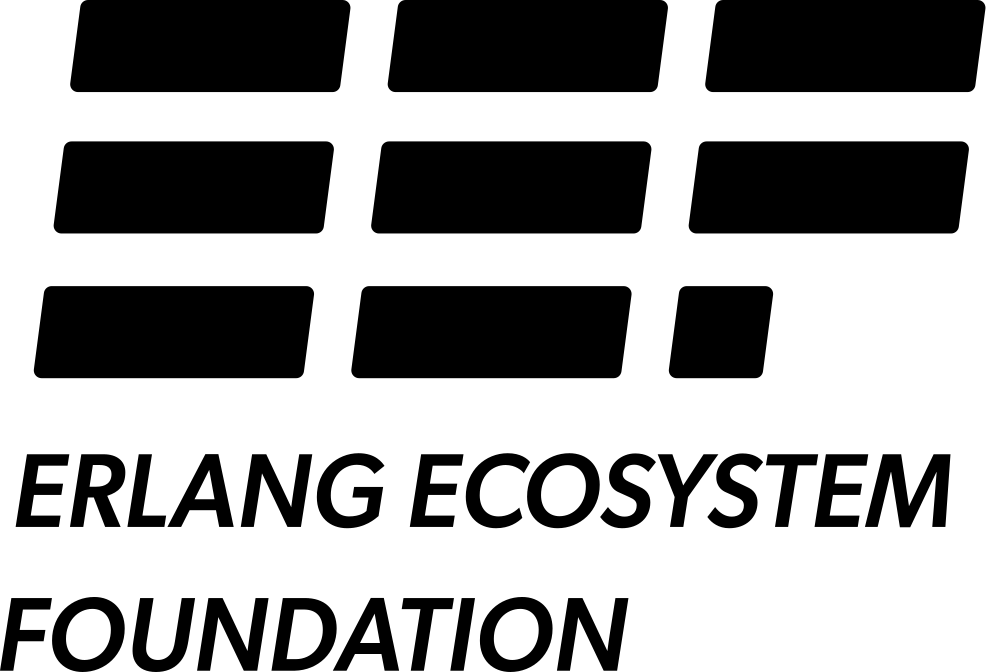

# Hologram

Build full-stack web apps entirely in Elixir. Hologram rebuilds the Elixir runtime in the browser, so your client-side code runs as Elixir, with no JavaScript framework and no JavaScript to write.

Website: https://hologram.page

## What it looks like

```elixir
defmodule MyApp.CounterPage do
  use Hologram.Page

  route "/counter"

  layout MyApp.MainLayout

  def init(_params, component, _server) do
    put_state(component, :count, 0)
  end

  def template do
    ~HOLO"""
    <p>Count: {@count}</p>
    <button $click="increment">+1</button>
    """
  end

  def action(:increment, _params, component) do
    put_state(component, :count, component.state.count + 1)
  end
end
```

The action runs in the browser, so the count updates instantly with no server round-trip.

## Get started

- [Installation](https://hologram.page/docs/installation)
- [Quick Start](https://hologram.page/docs/quick-start)
- [Documentation](https://hologram.page/docs/architecture)

If Hologram looks interesting, star the repo to follow along. It helps more Elixir developers find the project.

## Community

- Elixir Forum: https://elixirforum.com/hologram
- Discord: https://discord.gg/huJWNuqt8J
- Slack: https://elixir-lang.slack.com/channels/hologram

## Build in Public

- LinkedIn: https://www.linkedin.com/in/bartblast/
- X: https://x.com/Bart_Blast
- Bluesky: https://bsky.app/profile/bartblast.com

## Sponsors

### Main Sponsor

<a href="https://www.curiosum.com/?utm_source=github.com&utm_medium=sponsor-logo&utm_campaign=sponsoring_hologram" target="_blank">
  <picture>
    <source media="(prefers-color-scheme: dark)" srcset=".sponsors/curiosum_logo_white.png">
    <source media="(prefers-color-scheme: light)" srcset=".sponsors/curiosum_logo_black.png">
    
  </picture>
</a>

[Curiosum](https://www.curiosum.com/?utm_source=github.com&utm_medium=sponsor-logo&utm_campaign=sponsoring_hologram)

### Milestone Sponsor

<a href="https://erlef.org" target="_blank">
  <picture>
    <source media="(prefers-color-scheme: dark)" srcset=".sponsors/eef_logo_white.png">
    <source media="(prefers-color-scheme: light)" srcset=".sponsors/eef_logo_black.png">
    
  </picture>
</a>

[Erlang Ecosystem Foundation](https://erlef.org)

### Performance Sponsor

<a href="https://www.evostore.no/" target="_blank">
  <picture>
    <source media="(prefers-color-scheme: dark)" srcset=".sponsors/evo_store_logo_white.svg">
    <source media="(prefers-color-scheme: light)" srcset=".sponsors/evo_store_logo_black.svg">
    
  </picture>
</a>

[Evo Store](https://www.evostore.no/)

### Innovation Partner

<a href="https://sruplex.com" target="_blank">
  <picture>
    <source media="(prefers-color-scheme: dark)" srcset=".sponsors/sruplex_logo_white.svg">
    <source media="(prefers-color-scheme: light)" srcset=".sponsors/sruplex_logo_black.svg">
    
  </picture>
</a>

[Sruplex](https://sruplex.com)

### Framework Visionary

* [@absowoot](https://github.com/absowoot)
* Robert Urbańczyk, [@robertu](https://github.com/robertu)
* Moss Piglet, [@moss-piglet](https://github.com/moss-piglet)

### Early Adopter

* Daniel Calancea, [@D4no0](https://github.com/D4no0)
* [@pasila](https://github.com/pasila)
* Jonatan Männchen, [@maennchen](https://github.com/maennchen)
* James Harton, [@jimsynz](https://github.com/jimsynz)
* Ian Asaff, [@montague](https://github.com/montague)
* Max, [@Makesesama](https://github.com/Makesesama)

Thank you to **all other** sponsors for supporting the project!

If you find Hologram useful and would like to support its development, consider becoming a sponsor! Your contributions help improve the project and keep it alive.

[Become a Sponsor](https://github.com/sponsors/bartblast)

Thank you for your support!